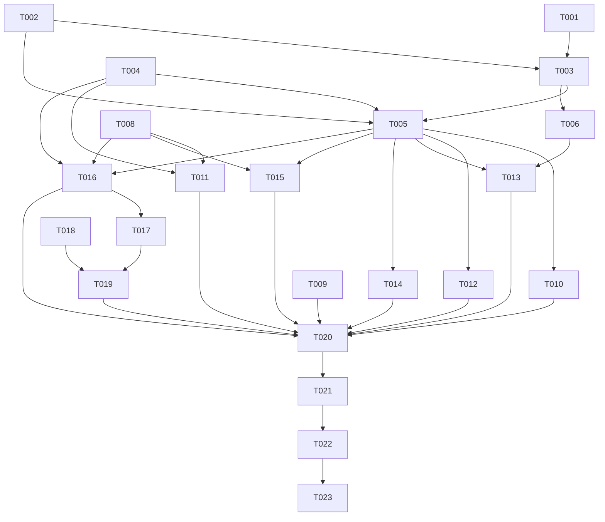

# Tasks: 全局高级搜索过滤（Global Search Filter）

**Input**: Design documents from `spec/global-search-filter/`
**Prerequisites**: plan.md（已就绪）、spec.md（已就绪）

**Tests**: 本功能未在 spec 中要求自动化测试任务；验证以契约脚本 + 构建为准（UI 验收由用户手动执行）。

**Organization**: 任务按用户故事分组；共享基础设施置于 Foundational 阶段。

## Format: `[ID] [P?] [Story] Description`

- **[P]**: 可并行（不同文件、无未完成依赖）
- **[Story]**: 所属用户故事（US1/US2/US3，映射 spec.md）
- 描述中的路径均为相对仓库根 `F:\work\Harmony\nextE` 的实际文件路径

## Path Conventions

- **多模块 HarmonyOS 工程**：所有任务路径相对仓库根 `F:\work\Harmony\nextE`
- **模块布局**：`entry/src/main/ets/`（路由注册与页面壳）、`feature/<模块>/src/main/ets/`（search/home/settings 业务模块）、`shared/src/main/ets/`（跨模块共享状态/组件/设置）
- **字符串资源**：`entry/src/main/resources/{base,zh_CN,en_US,ja_JP}/element/string.json`（4 locale 同步）
- **规范工件**：`spec/global-search-filter/`（本文档所在）
- **契约脚本**：`scripts/`（run_ci_preflight.sh、test_v1_decorator_inventory_contract.mjs、check_i18n_duplicates.py 等）
- 本功能全部任务落在既有模块内，不新建模块/顶层目录

---

## Phase 1: Setup（既有工程，无需初始化）

本项目为既有 HarmonyOS 多模块工程（entry/ + feature/* + shared/），无脚手架/依赖初始化需求。Setup 阶段无任务，直接进入 Foundational。

---

## Phase 2: Foundational（阻塞性前置，全部故事依赖）

**Purpose**: 全局过滤的共享状态、持久化、契约与资源，供三个用户故事共同依赖。

- [X] T001 [P] 新增持久化键常量 `GLOBAL_SEARCH_FILTER: string = 'search.globalFilter'`（命名与注释对齐既有 `SEARCH_FILTER` 行）到 `shared/src/main/ets/constants/StorageKeys.ets`
- [X] T002 [P] 新建 `shared/src/main/ets/state/GlobalSearchFilterState.ets`：`@ObservedV2` 类 `GlobalSearchFilterState`（`@Trace enabled/query/applySeq`，方法 `isActive()`/`mergedQuery(userQuery)`/`tagCount()`，合并语义 = 引号感知分词 + 用户 token 原文保留 + 过滤 token 完全相同字符串去重，见 plan.md D5）、键常量 `GLOBAL_SEARCH_FILTER_KEY = 'v2_globalSearchFilter'`、工厂 `connectGlobalSearchFilter()`、导出函数 `globalSearchFilterCacheRevision(profile: CustomProfile): string`（plan.md D4：非 gallery 或未激活恒等 `profile.contentRevision()`，否则追加 `':gf:'` + 长度前缀 query）
- [X] T003 新建 `shared/src/main/ets/settings/GlobalSearchFilterSettings.ets`：`GlobalFilterSnapshot {en, q}`、静态类 `GlobalSearchFilterSettings`（`restore(context)` 不 bump applySeq / `persist(context)` 250ms 防抖 / `flush(context)`，复用 `SearchFilterPersistScheduler` 独立实例，防御式 parse，写入前字符串相等跳过），持久化到 `StorageKeys.GLOBAL_SEARCH_FILTER`（依赖 T001、T002）
- [X] T004 [P] 在 `shared/src/main/ets/components/TagQueryComposer.ets` 新增导出 `@ObservedV2` 类 `TagQueryRowNameCache`（`@Trace names: Map<string, string>`；`ensure(context, query)` 经 `TagTranslationService.translateFullTagAsync` best-effort 补全翻译名；`nameOf(tag)` 查询，键 = `TagQuery.keyOf`），供两个编辑表面共用；不改动该文件既有导出与 `TabEditPage`
- [X] T005 在 `shared/src/main/ets/Index.ets` 导出新符号：`GlobalSearchFilterState`、`connectGlobalSearchFilter`、`globalSearchFilterCacheRevision`、`GlobalSearchFilterSettings`、`TagQueryRowNameCache`（依赖 T002、T003、T004）
- [X] T006 在 `shared/src/main/ets/settings/SettingsBootstrap.ets` 的 `loadForFirstContent` 第二个 `Promise.all` 组中注册 `GlobalSearchFilterSettings.restore(context)`（紧邻 `SearchFilterSettings.restore`）；本任务不改 `preloadPageCaches`（该改动属 US2 的 T013）（依赖 T003）
- [X] T007 [P] 在 `docs/plans/active/persistence-dataset-inventory.md` 新增行 `| StorageKeys.GLOBAL_SEARCH_FILTER | setting | plaintext | excluded | Global advanced-search filter (master switch + AND/OR/NOT tag query) |`（满足 `test_persistence_inventory_contract` 覆盖检查）
- [X] T008 [P] 在 `entry/src/main/resources/base/element/string.json`、`entry/src/main/resources/zh_CN/element/string.json`、`entry/src/main/resources/en_US/element/string.json`、`entry/src/main/resources/ja_JP/element/string.json` 四个 locale 同步新增字符串键：`global_filter_title`（面板区标题）、`global_filter_master_switch`（总开关行标题）、`global_filter_status_unconfigured`、`global_filter_status_enabled`、`global_filter_status_disabled`、`global_filter_hint`（措辞参考 plan.md 字符串资源契约；运行 `python3 scripts/check_i18n_duplicates.py` 确认无重复，重复则调整措辞或复用既有键）

**Checkpoint**: 共享状态/持久化/资源就绪，三个用户故事可开始。

---

## Phase 3: User Story 1 - 在搜索过滤面板配置全局排除并立即生效 (Priority: P1) 🎯 MVP

**Goal**: 搜索页过滤面板（画廊范围）内嵌"全局过滤"编辑区：总开关 + 联想添加 + 关系切换 + 滑动删除；每次修改实时持久化并立即重跑当前查询；搜索请求在构建期合并全局过滤词，不污染输入框与历史。

**Independent Test**: 打开搜索页 → 搜索任意词 → 打开过滤面板添加一个排除标签 → 结果立即刷新且被排除内容消失；再执行新搜索验证自动携带排除词而输入框/历史只含原始词。

- [X] T009 [P] [US1] 修改 `feature/search/src/main/ets/viewmodel/SearchViewModel.ets` 的 `buildQuery()`：`search` 字段改为 `this.scope === SEARCH_SCOPE_GALLERY ? connectGlobalSearchFilter().mergedQuery(this.query) : this.query`（favorite/watched 路径与 `buildFavQuery` 零改动；`this.query` 保持原始词）
- [X] T010 [US1] 修改 `feature/search/src/main/ets/pages/GallerySearchPage.ets`：新增 `@Local globalFilter: GlobalSearchFilterState = connectGlobalSearchFilter()` 与 `@Monitor('globalFilter.applySeq') onGlobalFilterApply()`（回调内 `GlobalSearchFilterSettings.persist(this.ctx())`；`this.fieldState.keyword.trim().length > 0` 时 `this.vm.reapplyFilters()`；导入新符号）（依赖 T005）
- [X] T011 [US1] 修改 `feature/search/src/main/ets/components/SearchFilterSheet.ets`：当 `session.scope === SEARCH_SCOPE_GALLERY` 时在既有 `ListItem` 之后追加"全局过滤"区——总开关行（`ConciseListRow({hasSwitch: true})` 绑定 `gf.enabled`）+ `GroupedListItemSection`（header = 区标题 + `TagQueryComposer({query: gf.query, onQueryChange})`；内容 = `ForEach(TagQuery.parse(gf.query))` → `ListItem(TagRow).swipeAction(删除)`，relation 切换与删除经 parse/serialize 往返回写 `gf.query`）；每次变更 `gf.applySeq++`；行显示名经 `TagQueryRowNameCache`；`resetFilter()` 与 reset 按钮不触碰 `gf`；面板自身不直接持久化（由 T010 宿主 monitor 负责）；favorite/watched scope 下该区整体不渲染（依赖 T004、T005、T008）

**Checkpoint**: US1 独立可测——过滤面板内配置全局过滤并立即生效于画廊搜索。

---

## Phase 4: User Story 2 - 首页画廊列表与无关键词浏览同样生效 (Priority: P2)

**Goal**: 首页画廊类列表（内置"首页"画廊 profile 无关键词浏览、自定义画廊类型标签页）请求自动合并全局过滤词；缓存键按过滤状态隔离；过滤变更时已加载的画廊 tab 自动刷新。

**Independent Test**: 启用含一个排除标签的全局过滤 → 打开首页"首页"标签 → 列表无被排除内容；修改全局过滤 → 首页画廊列表自动刷新；watched/收藏/热门/排行不受影响。

- [X] T012 [US2] 修改 `feature/home/src/main/ets/viewmodel/GalleryListViewModel.ets`：(a) `buildQuery()` 中当 `useProfile && p!.listType === PROFILE_TYPE_GALLERY` 时 `search` 字段经 `connectGlobalSearchFilter().mergedQuery(p!.searchText)`（其余分支字节级不变）；(b) `cacheKey()` 的 profile 分支 revision 改用 `globalSearchFilterCacheRevision(this.profile)`（`homeListKey` 分支与 `profileContentRevision()`/`GalleryFirstPageRun` 的 run 身份比较保持不变）（依赖 T005）
- [X] T013 [US2] 修改 `shared/src/main/ets/settings/SettingsBootstrap.ets` 的 `preloadPageCaches()`：selectedProfile 与 profiles 遍历处全部 `homeProfileKey(...)` 调用的 revision 改用 `globalSearchFilterCacheRevision(p)`（toplist/favorites 预热键不变；恢复时序已保证 restore 先于本函数执行）（依赖 T005、T006）
- [X] T014 [US2] 修改 `feature/home/src/main/ets/components/GallerySourcePage.ets`：新增 `@Local globalFilter: GlobalSearchFilterState = connectGlobalSearchFilter()` 与 `@Monitor('globalFilter.applySeq') onGlobalFilterChange()`（回调内：当前 profile 存在且 `listType === PROFILE_TYPE_GALLERY` 且 `loadedOnce` 时 `this.vm.reload(true)`；watched/favorite/popular/toplist tab 无动作）（依赖 T005）

**Checkpoint**: US1+US2 均独立可测——全局过滤覆盖搜索与首页画廊列表/纯浏览，缓存隔离，自动刷新。

---

## Phase 5: User Story 3 - 设置→搜索 中查看状态并管理 (Priority: P3)

**Goal**: 设置→搜索 新增"全局搜索过滤"状态行（未配置/已启用 N 个标签/已停用 N 个标签）与管理入口；编辑页提供与过滤面板一致的编辑能力，修改即时持久化并全局生效。

**Independent Test**: 配置若干全局过滤标签 → 设置→搜索 状态行正确 → 经管理入口进入编辑页删除一个标签 → 状态更新且新搜索/列表生效。

- [x] T015 [P] [US3] 修改 `feature/settings/src/main/ets/pages/SearchSettingsPage.ets`：新增"全局搜索过滤"分组——状态行（`ConciseListRow`：subtitle = 未配置/已启用/已停用（D11 派生规则），trailingText = `${globalFilter.tagCount()}`）+ 管理入口行（chevron，action → `this.stack.pushPathByName('GlobalSearchFilter')`）（依赖 T005、T008）
- [x] T016 [US3] 新建 `feature/settings/src/main/ets/pages/GlobalSearchFilterPage.ets`：`@ComponentV2` + `HdsNavDestination` + `SecondaryListScaffold` 骨架（对齐 `SearchSettingsPage`）：总开关行（`ConciseListRow hasSwitch` 绑 `gf.enabled`）+ `GroupedListItemSection`（header = `TagQueryComposer`；内容 = `TagRow` 滑动删除行，relation 切换/删除经 parse/serialize 往返）；每次变更 `gf.applySeq++` + `GlobalSearchFilterSettings.persist(ctx)`；`aboutToDisappear` 时 `flush(ctx)`；行显示名经 `TagQueryRowNameCache`；标题用 `global_filter_title`（依赖 T004、T005、T008）
- [x] T017 [US3] 修改 `feature/settings/src/main/ets/Index.ets`：`export { GlobalSearchFilterPage } from './pages/GlobalSearchFilterPage'`（依赖 T016）
- [x] T018 [P] [US3] 修改 `entry/src/main/ets/model/IndexRouteCoordinator.ets`：路由名类型联合加 `'globalSearchFilter'`，映射表加 `'GlobalSearchFilter': 'globalSearchFilter'`（对齐既有 `'SearchSettings'` 行）
- [x] T019 [US3] 修改 `entry/src/main/ets/pages/Index.ets`：从 `'settings'` 导入 `GlobalSearchFilterPage`；新增 `function IndexGlobalSearchFilterRoute() { GlobalSearchFilterPage() }`；手写 routerMap 加 `'globalSearchFilter': wrapBuilder<[]>(IndexGlobalSearchFilterRoute)`（对齐既有 `searchSettings` 注册）（依赖 T017、T018）

**Checkpoint**: 三个用户故事全部独立可测。

---

## Phase 6: Polish（横切自查）

**Purpose**: 跨故事一致性与约束合规检查。

- [x] T020 全仓自查：新增代码仅用 V2 装饰器（`@ObservedV2/@Trace/@Local/@Monitor/@ComponentV2/@Param/@Event`）；无 `any`/对象字面量类型/未导出引用；无遗留 TODO；`TabEditPage`、`EhApiService`、样式基线零改动；新增字符串四 locale 齐全；运行 `node scripts/test_v1_decorator_inventory_contract.mjs` 确认 `0 file(s)`（改动散布于前述各文件）

---

## Phase 7: Verification

<!-- verification_scope: build-only -->

**Purpose**: 契约脚本与构建验证（UI 验收由用户手动执行，不在自动验证范围）。

- [x] T021 运行 `bash scripts/run_ci_preflight.sh`（all）并修复直至全绿：重点 `test_v1_decorator_inventory_contract.mjs`（必须 `0 file(s)`）、`test_app_storage_v2_key_contract.mjs`（新键 `v2_globalSearchFilter` 常量暴露且唯一）、`test_persistence_inventory_contract.mjs`（新 StorageKeys 成员有清单行）、`check_i18n_duplicates.py`（新字符串无重复）及其余 severe 契约
- [x] T022 运行 `devecocli build` 并修复编译错误直至成功（新增/修改文件见 Phase 2–5）
- [ ] T023 部署验证：仅在存在用户明确指定的 HDC 目标时执行 `devecocli run --skip-build`；无目标时跳过并在验证报告中注明"设备验收待用户执行"（遵守仓库设备协议：无默认设备，不得从历史推断目标）

---

## Dependencies & Execution Order

### Phase Dependencies

- **Phase 1 Setup**: 无任务。
- **Phase 2 Foundational**: T001–T008，阻塞所有用户故事；T003 依赖 T001+T002；T005 依赖 T002+T003+T004；T006 依赖 T003。
- **Phase 3 (US1)**: 依赖 T005（+T004/T008）；T009 与 T011 不同文件可并行，T010 建议在 T009 后接线验证。
- **Phase 4 (US2)**: 依赖 T005+T006；T012/T014 在 feature/home，T013 在 shared。
- **Phase 5 (US3)**: 依赖 T004+T005+T008；T019 依赖 T017+T018。
- **Phase 6 Polish**: 依赖全部故事完成。
- **Phase 7 Verification**: 依赖 Polish 完成；T021 → T022 → T023 顺序执行。

### User Story Dependencies

- **US1 (P1)**: Foundational 后即可开始，MVP 核心。
- **US2 (P2)**: Foundational 后即可开始；与 US1 无文件冲突（feature/home + shared vs feature/search）。
- **US3 (P3)**: Foundational 后即可开始；编辑页复用 US1 的共享原语（TagQueryComposer/TagRow/TagQueryRowNameCache），但接线独立。

## 📊 Dependency Graph



## ⚡ Parallel Execution Guide

| Phase | Tasks | Required Files | Execution Notes |
| --- | --- | --- | --- |
| Foundational | T001, T002, T004, T007, T008 | StorageKeys.ets / 新 state 文件 / TagQueryComposer.ets / 清单文档 / 4×string.json | 互不冲突，可并行 |
| Foundational | T003 | 新 settings 文件 | 等 T001+T002 |
| Foundational | T005, T006 | shared Index.ets / SettingsBootstrap.ets | 等 T003/T004 |
| US1 | T009 ∥ T011 | SearchViewModel.ets ∥ SearchFilterSheet.ets | 不同文件可并行；T010 随后接线 |
| US2 | T012 ∥ T014 | GalleryListViewModel.ets ∥ GallerySourcePage.ets | 与 T013（shared）可交错 |
| US3 | T015 ∥ T018 ∥ (T016 → T017 → T019) | SearchSettingsPage.ets ∥ IndexRouteCoordinator.ets ∥ 新页+导出+Index.ets | 三条线互不冲突 |
| Verification | T021 → T022 → T023 | 脚本/构建 | 严格顺序 |

## Parallel Example: User Story 1

```bash
# US1 内不同文件的任务可并行推进（互不依赖、文件不冲突）：
Task: "T009 [P] [US1] SearchViewModel.buildQuery 合并"   # feature/search/.../viewmodel/SearchViewModel.ets
Task: "T011 [P] [US1] SearchFilterSheet 全局过滤区"      # feature/search/.../components/SearchFilterSheet.ets

# 接线任务在上述任务完成后执行：
Task: "T010 [US1] GallerySearchPage monitor 接线"        # feature/search/.../pages/GallerySearchPage.ets
```

## Implementation Strategy

### MVP First (User Story 1 Only)

1. Complete Phase 2: Foundational（T001–T008）
2. Complete Phase 3: User Story 1（T009–T011）
3. **STOP and VALIDATE**: 过滤面板配置全局排除 → 当前搜索立即生效（见 US1 Independent Test）
4. 此即最小可用增量（MVP）

### Incremental Delivery

1. Foundational → 共享状态/持久化/资源就绪
2. +US1 → 面板配置、搜索即时生效（MVP）
3. +US2 → 首页画廊列表/纯浏览生效 + 缓存隔离 + 自动刷新
4. +US3 → 设置入口/状态行/独立编辑页
5. Polish → 跨故事自查
6. Verification → 契约脚本 + 构建（+条件部署）

### Single-Agent Sequential Policy

本仓库由单一实现代理顺序执行：按 T001→T020 的 ID 顺序推进；[P] 标记用于识别"即使交错执行也不冲突"的任务组，实际按 ID 顺序执行即可；T021–T023 属验证阶段，不在实现范围。

---

## Summary Report

- **总任务数**: 23（T001–T023）
- **按阶段**: Foundational 8 · US1 3 · US2 3 · US3 5 · Polish 1 · Verification 3
- **每故事独立测试判据**: 见各故事 "Independent Test"（映射 spec.md User Scenarios）
- **并行机会**: Foundational 5 项可并行（T001/T002/T004/T007/T008）；US1 内 T009∥T011；US2 内 T012∥T014；US3 内 T015∥T018 与页面注册链并行
- **MVP 范围建议**: Phase 2 + Phase 3（US1）即构成最小可用增量（面板配置→搜索立即生效）
- **格式自检**: ✅ 全部任务以 `- [ ]` 开头、ID 连续唯一、故事任务带 `[USx]`、非故事任务无标签、描述含具体文件路径

---

## Notes

- [P] 任务 = 不同文件、无未完成依赖
- [Story] 标签映射 spec.md 用户故事（US1=P1 / US2=P2 / US3=P3）
- 每个用户故事可独立完成与验证（见各故事 Independent Test）；可在任意 Checkpoint 暂停验证
- 硬约束（AGENTS.md）：仅 V2 状态装饰器；未经明确允许不改样式；`TabEditPage`/`EhApiService` 零改动；无默认设备（T023 需用户指定 HDC 目标）；禁止创建 Git 工作树
- 验证阶段任务（T021–T023）由验证代理执行，不属实现代理范围
- 实现代理不提交/推送；完成后返回实现报告
